  <picture>
    <source media="(prefers-color-scheme: dark)" srcset="docs/assets/bramble-banner-dark.svg">
    
  </picture>

# Bramble

**A zero-config, patchwork personal compute mesh.**

Bramble is a distributed computing engine designed for the homestead, the local network, and the off-grid enclosure. It turns a random assortment of mismatched hardware into a single, self-healing, hardware-agnostic cluster.

No cloud dependencies. No YAML hell. No central master nodes. Just throw your boxes in a shed, power them on, and they figure it out.

## Project Status & Disclaimer

> [!WARNING]
> **Bramble is currently a hypothetical architecture and design concept.** There is no runtime to install yet.
>
> It represents an exploration into the endgame of personal infrastructure and digital sovereignty. To see the foundational primitives and philosophy that lead to this concept, check out previous experiments in browser-based, local-first computing: the [Local Peer-to-Peer API](https://github.com/WICG/local-peer-to-peer), [go-lp2p](https://github.com/backkem/go-lp2p), [SETTLE](https://github.com/michaelrsweet/settle), the [Open Screen Protocol](https://github.com/w3c/openscreenprotocol), and [CodeCAD](https://github.com/backkem/codecad). Adjacent non-browser prior art is worth studying too: notably [Matter](https://github.com/backkem/matter), whose [mDNS discovery](https://github.com/pion/mdns) and [PAKE secure channels](https://github.com/backkem/spake2-go) [overlap](https://github.com/w3c/openscreenprotocol/issues/308) with these web standards.
>
> Have thoughts on the design? Come poke holes in it over in [Discussions](https://github.com/backkem/bramble/discussions).

## The Ethos

Modern infrastructure relies on centralizing power, both physically and computationally. The "smart home" is a brittle leash tethered to a megacorp's servers. The traditional "homelab" is a fragile stack of static IPs, subnets, and strict-consensus clusters that panic the moment a router reboots.

Bramble is designed for digital permaculture. It assumes networks will partition, power will fluctuate, and hardware will be whatever you could scavenge or buy cheap. It gives you localized, zero-maintenance compute sovereignty, so you can spend less time fixing servers and more time tending to your garden.

## Core Architecture

Bramble is built on four core primitives:

### 1. The Universal Binary
Bramble doesn't use heavy containers. It uses a lightweight, architecture-agnostic bytecode format. You don't need to know or care if your node is an old x86 laptop, an ARM-based Raspberry Pi, or a weird RISC-V board you bought on AliExpress. If a node joins the mesh, Bramble can execute your workloads on it. Cold starts take milliseconds.

### 2. The Self-Healing Mesh
There is no DNS to configure, no subnets to map, and no VPNs to manage. Bramble nodes use local peer-to-peer protocols to automatically discover each other over Ethernet, Wi-Fi, or whatever transport they share. They form a flat, encrypted virtual network. If node A needs to talk to node C, the mesh routes it through node B automatically.

### 3. Eventual Consistency
Traditional orchestrators require a strict quorum. If the network splits, the cluster freezes. Bramble embraces the chaos of the physical world. It uses gossip protocols and eventual consistency. If the node in your solar-powered barn loses Wi-Fi, it keeps running its local workloads. When it reconnects, the mesh quietly synchronizes state. It acts like mycelium, routing resources and data wherever the network is healthy.

### 4. Cloudless Ingress
You don't need to expose ports to the internet or run a reverse proxy to check your dashboards. Bramble natively uses direct browser-to-peer protocols to create an encrypted connection between your web browser and the nearest physical node on your property. You just open a local web page, and you are securely connected to your entire mesh.

## Getting Started

> **TODO:** Implementation is in the design phase.
> *Instructions for building from source, starting the daemon, and deploying your first workload will go here once the initial runtime is functional.*

## What Bramble Is (and Isn't)

**Bramble IS:**
*   A localized, self-hosted orchestrator for automation, data processing, and IoT.
*   Hardware and architecture agnostic.
*   Fundamentally anti-authoritarian. No central servers, no phoning home.

**Bramble IS NOT:**
*   An incentivized global network or public community grid running on someone else's hardware.
*   A global CDN or replacement for AWS.
*   Designed for massive, high-frequency financial trading systems that require strict microsecond consensus.
*   Going to text you asking to update your subscription.

## The Technology Stack
For the engineers wanting to look under the hood, Bramble aggressively cannibalizes existing standards:
*   **Compute:** Industry-standard WebAssembly (WASM) runtimes (Bytecode Alliance compatible) providing secure, sandboxed execution.
*   **Orchestration:** Lightweight, distributed scheduling inspired by clustering APIs (like K3s), but backed by partition-tolerant data structures (CRDTs/gossip).
*   **Networking:** Seamless P2P routing and browser-to-mesh standards (like the [Local Peer-to-Peer API](https://github.com/WICG/local-peer-to-peer) and [WebRTC](https://github.com/pion/webrtc)) for native ingress.

## Contribute
If you want to help build the infrastructure for the post-scarcity homestead, PRs are welcome. We value simplicity, offline-first reliability, and code that doesn't wake us up at 3 AM.

*Plant the seed. Let the bramble grow.*
